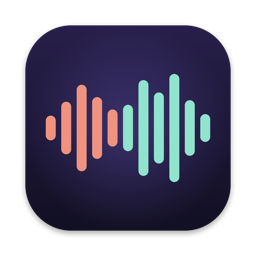
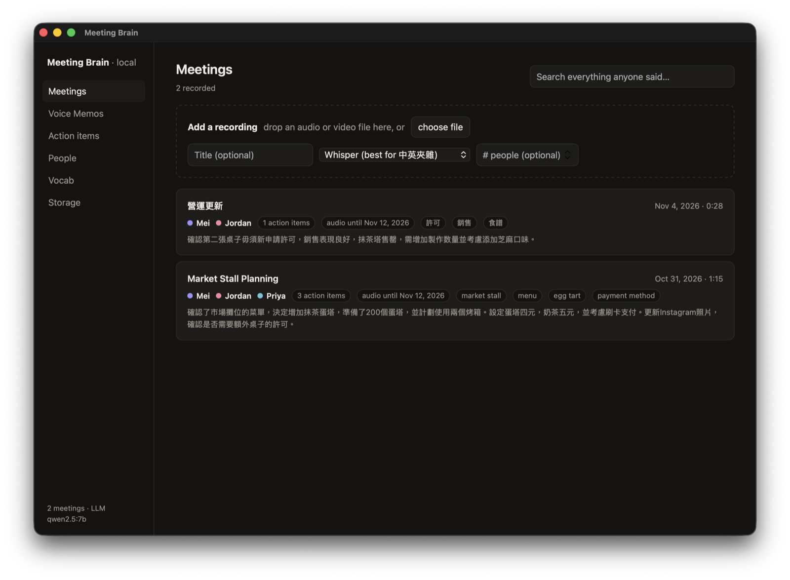
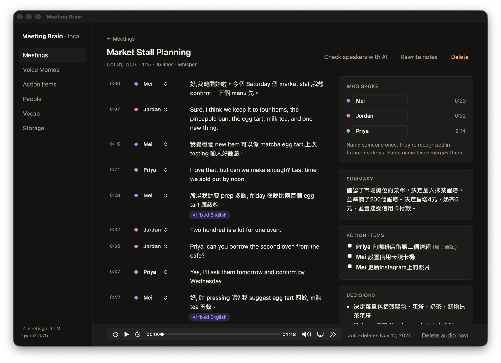
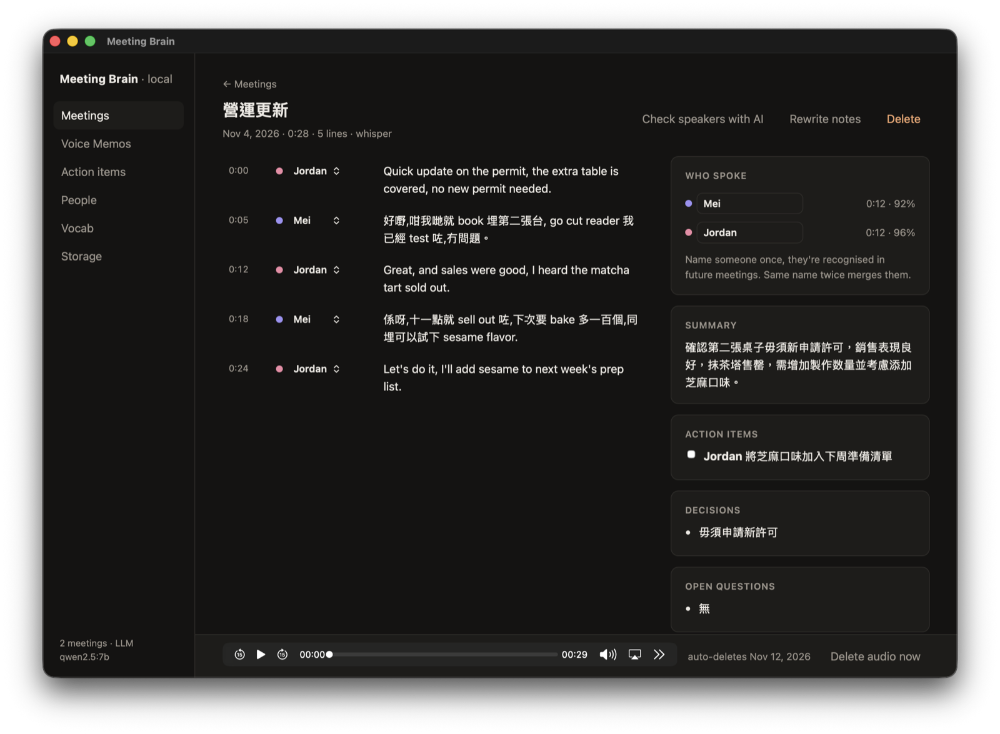
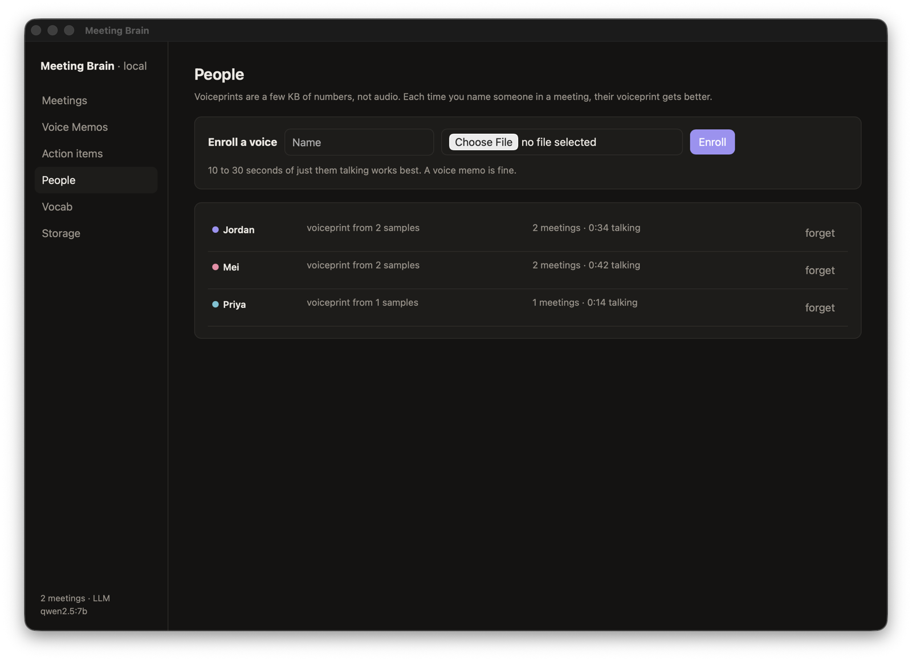
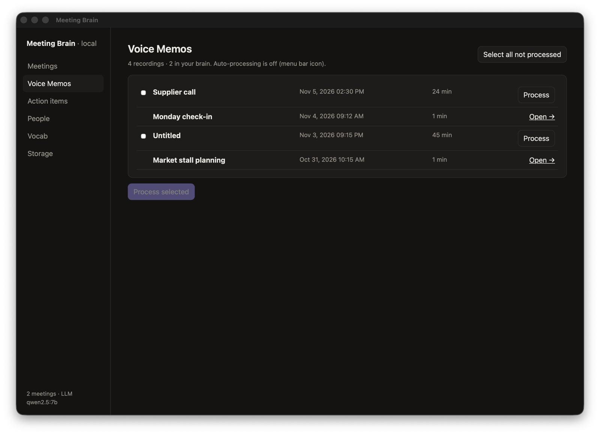
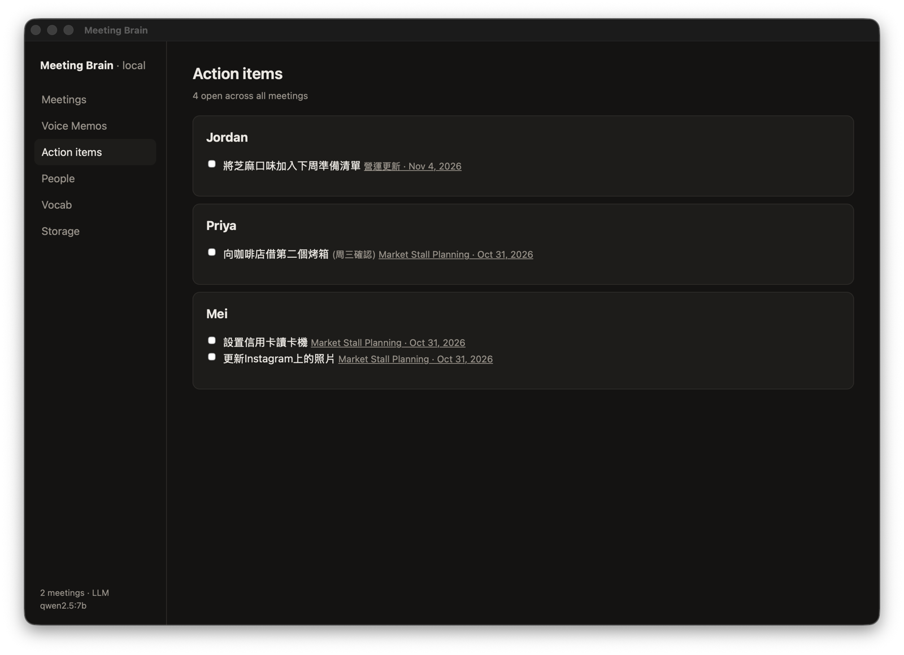

<p align="center">
  
</p>
<h1 align="center">Meeting Brain</h1>

<!-- YOUR INTRO HERE: what this is and why you built it, in your words. -->

Everything runs on your Mac locally. Recordings, transcripts, voiceprints and notes never leave it.



*Screenshots use a made-up bakery team (Mei, Jordan, Priya) voiced with macOS text-to-speech and run
through the real pipeline. No real meeting appears anywhere in this repo.*

## What it does

### Who said what, by voice

Every line is labelled with a speaker from voiceprints, not from what they say. Lines where the local
model fixed English that speech recognition heard as Cantonese homophones are badged **AI fixed
English** (hover to see the original). Summary, action items, decisions and open questions sit next to
the transcript, and clicking a line plays it.



### Cantonese and English in the same sentence

Whisper large-v3 is forced to Cantonese (`yue`) with a mixed-language prompt plus your own vocabulary,
so 「我覺得個 new item 可以係 matcha egg tart」 stays as said. In testing it beat SenseVoice clearly on
mid-sentence switching.

### Other languages

Pick the meeting language per recording, or set a default in Settings. Presets: Cantonese + English
(default), Mandarin + English (Simplified or Traditional), Japanese, Korean, Spanish, French, English
and auto-detect. Voiceprints work in any language. On short test clips, Mandarin, Japanese and Korean
kept English words in English with both speakers right. Any sentence Whisper skips (it dropped an
English reply in a Spanish meeting) gets a second pass on its own with the language auto-detected.

### Name someone once

Type a name in **Who spoke** and that voiceprint is remembered. In the next meeting below, nobody was
named and no head count was given. Mei (92%) and Jordan (96%) were recognised on their own.



Voiceprints are a few KB of numbers, not audio, and get better each time you confirm someone.



### Voice Memos, no exporting

The Mac app reads Voice Memos directly. New recordings over a minimum length (5 min by default) are
processed on their own once you stop recording. Older ones are one click away, and each memo is only
ever processed once. If the engine stops mid-way, the memo is picked up again on the next launch.



### Export

Every meeting exports as PDF, Word, Markdown or plain text, with the names you gave people, the lines
you fixed, and the notes. There's also a transcript-only text option. From the app, files land in
Downloads.

### Action items across meetings



### Audio cleans up after itself

Audio is kept as 16 kbps Opus (about 7 MB per hour) and deleted after 7 days. Transcripts and notes
stay and are searchable. Each meeting is also exported as Markdown to `data/notes/`.

## Setup

macOS on Apple Silicon. You need [uv](https://docs.astral.sh/uv/), ffmpeg, whisper.cpp and Ollama:

```sh
brew install uv ffmpeg whisper-cpp ollama
git clone <this repo> && cd meeting-brain
scripts/get-models.sh          # about 3.4 GB, mostly Whisper large-v3
ollama pull qwen2.5:7b         # notes + English fixes, optional
uv run mb serve                # dashboard at http://localhost:4470
```

Already have `ggml-large-v3.bin`? Set `MB_WHISPER_MODEL=/path/to/it` and the script skips it.

### Mac app

```sh
mac/build.sh                   # installs ~/Applications/MeetingBrain.app
```

Open it, then turn it on under System Settings > Privacy & Security > Full Disk Access so it can read
Voice Memos. It only reads recordings and never changes or deletes them. The app starts the engine
itself at low priority (2 threads), so long recordings take longer but the fans stay quiet.

### Command line

```sh
uv run mb process meeting.m4a --speakers 3    # head count is optional
uv run mb process call.m4a --lang ja          # yue (default), zh, zh-tw, ja, ko, es, fr, en, auto
uv run mb record --title "weekly sync"        # records the mic until Ctrl-C, then processes
uv run mb enroll Mei mei-voice-memo.m4a       # 10 to 30 s of just them
uv run mb vocab add TestFlight "test flight"  # a term and how it gets misheard
uv run mb compress lecture.mp4                # 720p, 10 fps HEVC + Opus for long lectures
uv run mb export-finetune pairs.jsonl         # your corrections as training pairs
```

## Tips

- **Similar voices merging?** Give the head count (`--speakers N` or the field in the dashboard). In
  the demo, the two English voices merged without it and all three separated cleanly with it.
- **Same person split in two?** Type the same name on both. They merge, and the voiceprint learns.
- **A word keeps coming out wrong?** Fix the line in the dashboard. New English words you type are
  added to your vocab automatically and used in the next meeting.

## How it works

1. Silero VAD cuts speech at pauses. pyannote segmentation 3.0 adds cuts at speaker changes with no
   pause (interruptions) and flags overlapping speech.
2. Each utterance gets a CAM++ zh/en voiceprint. Voiceprints are clustered by cosine similarity, small
   stray clusters are folded into their nearest speaker, and clusters are matched to people you have
   named before.
3. Whisper large-v3 transcribes with Cantonese forced, a code-switching style prompt and your vocab.
   OpenCC turns the output into Hong Kong Traditional Chinese.
4. A local LLM through Ollama fixes English heard as Cantonese homophones, then writes the notes.
   Fixes that change too much of the original Chinese are rejected.
5. Lines you correct are kept as short clips in `data/train/` for fine-tuning later.

## Limits

- Notes come from a 7B local model. Expect the odd wrong owner on an action item and summaries that
  drift into written Chinese. Every AI change to the transcript is badged so you can check it.
- Diarization is tested on synthetic voices and a small number of real meetings, not a benchmark.
- macOS only. The engine is plain Python and could run elsewhere, but the app and setup assume a Mac.

## Settings (env vars)

| Variable | Default | What it does |
| --- | --- | --- |
| `MB_OLLAMA_MODEL` | `qwen2.5:7b` | Model for fixes and notes |
| `MB_CLUSTER_THRESHOLD` | `0.4` | Lower means fewer speakers |
| `MB_ENROLL_MATCH` | `0.55` | How sure it must be to name a known person |
| `MB_RETENTION_DAYS` | `7` | Days before audio is deleted |
| `MB_THREADS` | `4` | CPU threads for the models |
| `MB_WHISPER_MODEL` | `models/ggml-large-v3.bin` | Path to Whisper |
| `MB_LANG` | `yue` | Default meeting language |
| `MB_DATA` | `data/` | Where the database, audio and notes live |
| `MB_ALLOW_BIG_MODEL` | off | Lets a model over 40% of RAM load (it refuses by default) |
| `MB_REASON_SPEAKERS` | off | Experimental LLM speaker hints |

## Models

From the [sherpa-onnx releases](https://github.com/k2-fsa/sherpa-onnx/releases): pyannote
segmentation 3.0, 3D-Speaker CAM++ (zh/en), Silero VAD and SenseVoice (int8). From Hugging Face:
[whisper.cpp large-v3](https://huggingface.co/ggerganov/whisper.cpp) and the
[whisper.cpp Silero VAD](https://huggingface.co/ggml-org/whisper-vad). `scripts/get-models.sh`
downloads all of them.

## License

MIT
